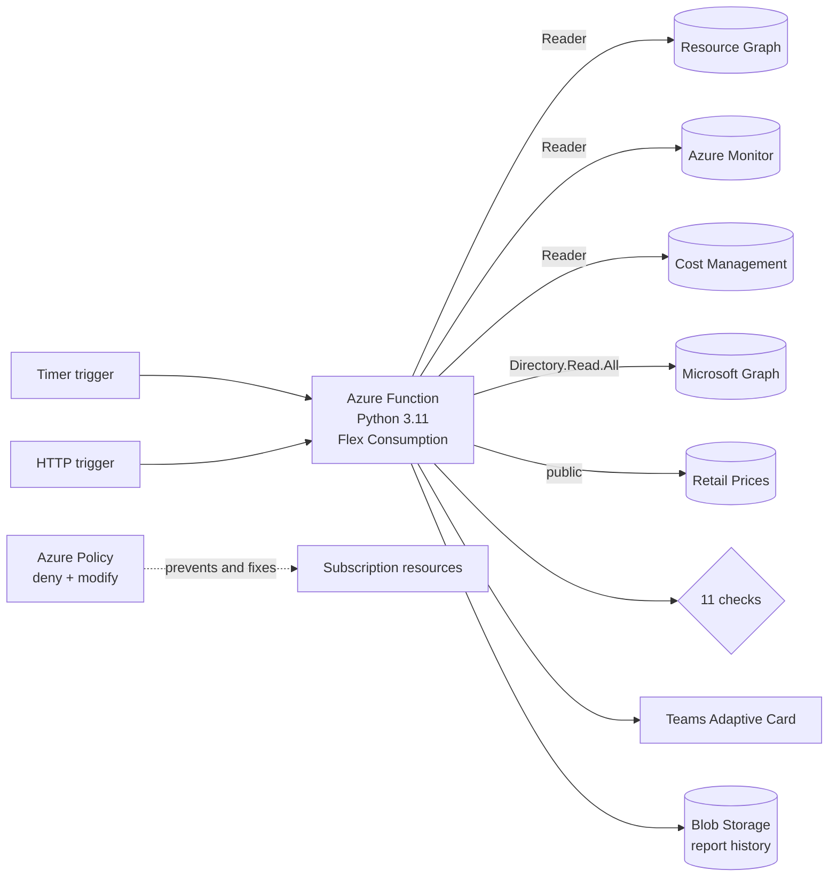

# Azure Governance Bot

Serverless governance and cost-optimization scanner for Microsoft Azure. It inventories every in-scope subscription through Azure Resource Graph, combines that with Azure Monitor metrics, Microsoft Graph and Cost Management data to find wasted spend, governance gaps, risky access and unusual cost, and publishes a summary to Microsoft Teams. Azure Policy prevents and auto-remediates tagging gaps, so the scanner reports only what policy can't fix. Infrastructure is defined in Bicep and deployed by GitHub Actions without any stored secrets.




## Capabilities

| Area | Check | Detects |
|---|---|---|
| Waste | `orphaned-disk` | Unattached managed disks |
| | `orphaned-public-ip` | Public IPs not associated with a NIC, load balancer, gateway or NAT gateway |
| | `orphaned-nic` | NICs not attached to a VM (Azure-managed NICs excluded) |
| | `empty-app-service-plan` | Paid App Service Plans hosting no apps |
| | `stopped-not-deallocated-vm` | VMs stopped from the guest OS that still bill for compute, priced from the Retail Prices API |
| | `idle-vm` | Running VMs with low average and low peak CPU over 14 days, with their monthly cost |
| Governance | `untagged-resource` | Resources missing required ownership or cost-allocation tags |
| | Azure Policy | Deny resource groups without `owner`; inherit tags from the resource group; remediate existing resources |
| Identity | `broad-role-assignment` | Owner, Contributor or access-granting roles at subscription, management-group or root scope |
| | `stale-role-assignment` | Role assignments held by deleted principals or disabled users |
| | `custom-role-wildcard` | Custom roles granting `*` or provider-wide wildcard actions |
| Cost | `cost-anomaly` | A resource group's daily spend far outside its 14-day baseline, or brand-new spend |

## Key design decisions

- **Azure Resource Graph for inventory.** One KQL query spans all subscriptions and returns from an index, instead of thousands of per-resource ARM calls subject to throttling.
- **Secretless everywhere.** The Function App uses a managed identity for Azure, storage, Key Vault and Microsoft Graph, with storage shared keys disabled. GitHub Actions deploys through OIDC workload identity federation, with no client secret to store or rotate.
- **Least privilege.** The scanner holds Reader on the subscription and `Directory.Read.All` in Graph, both read-only. The deployment identity's ability to grant roles is limited by a role-assignment condition to the three roles the template needs.
- **Prevent, then detect.** Azure Policy stops tagging problems at creation time. The scanner never modifies anything and reports what policy can't judge, such as idle, orphaned or anomalous resources.
- **Explainable cost anomalies.** A rolling mean and standard deviation per resource group, plus a minimum dollar threshold. No training data, and every flag can be explained in one sentence.
- **Injected dependencies.** Scanners receive a `Clients` container instead of creating SDK clients, so every Azure service has an in-memory fake and the test suite runs offline.
- **Failure isolation.** A failing check, VM metric call, price lookup, history write or Teams post is logged without stopping the rest. If Microsoft Graph is unreachable, the stale-assignment check fails loudly instead of reporting every principal as deleted.
- **Observable in production.** Application Insights collects telemetry, with alerts on any failed run and on two days without a successful scan.

Details are in [docs/ARCHITECTURE.md](docs/ARCHITECTURE.md).

## Getting started

```bash
python -m venv .venv && source .venv/bin/activate   # Windows: .venv\Scripts\activate
pip install -r requirements-dev.txt
pytest                                              # no Azure account required

az login
python -m governance.cli -v                         # read-only scan
./scripts/e2e.sh                                    # full test against your subscription
```

- [docs/GETTING_STARTED.md](docs/GETTING_STARTED.md): first run, test environments, Azure Policy
- [docs/DEPLOYMENT.md](docs/DEPLOYMENT.md): Bicep, GitHub Actions with OIDC, Graph permissions

## Configuration

| Variable | Default | Purpose |
|---|---|---|
| `GOV_SUBSCRIPTION_IDS` | *(all visible)* | Comma-separated subscription IDs to scan |
| `GOV_REQUIRED_TAGS` | `owner,environment,costCenter` | Tags every resource must carry |
| `GOV_SCHEDULE` | `0 0 14 * * 1-5` | NCRONTAB schedule for the timer trigger (UTC); the Bicep deployment uses daily |
| `TEAMS_WEBHOOK_URL` | *(unset)* | Teams Workflow webhook; a Key Vault reference when deployed |
| `GOV_IDLE_LOOKBACK_DAYS` | `14` | Days of CPU history evaluated for idle VMs |
| `GOV_IDLE_CPU_AVG` | `5` | Average CPU % below which a VM is idle |
| `GOV_IDLE_CPU_MAX` | `20` | Peak CPU % the VM must never exceed to count as idle |
| `GOV_IDLE_MIN_HOURS` | `72` | Minimum hours of metric data before a VM is judged |
| `GOV_RBAC_ALLOWED_PRINCIPALS` | *(none)* | Principal object IDs exempt from the broad-role check |
| `GOV_COST_BASELINE_DAYS` | `14` | Days of history each day's cost is compared against |
| `GOV_COST_ANOMALY_SIGMA` | `3` | Standard deviations above the baseline mean that count as anomalous |
| `GOV_COST_ANOMALY_MIN_USD` | `5` | Minimum daily increase to report, so small groups don't trigger |
| `GOV_REPORT_STORAGE_URL` | *(unset)* | Blob endpoint for report history; set automatically when deployed |
| `GOV_REPORT_CONTAINER` | `reports` | Container for report history |
| `GOV_DRY_RUN` | `true` | Report-only mode |

## Repository layout

```
function_app.py            Azure Functions entry point (timer and HTTP triggers)
governance/
  config.py                Environment-based settings
  models.py                Finding and ScanReport models
  azure_clients.py         Clients for Resource Graph, Monitor, Graph, Cost Management, prices
  runner.py                Scan orchestration
  cli.py                   Command-line entry point
  scanners/                One module per check
  reporting/               Teams Adaptive Card and Blob Storage history
infra/                     Bicep: subscription-scope deployment and app module
.github/workflows/         CI (tests, lint, Bicep, shellcheck) and OIDC deployment
tests/                     pytest suite using in-memory fakes for every Azure service
scripts/                   Test environments, end-to-end test, Policy, deployment setup
docs/                      Architecture, getting started, deployment, roadmap
```

## License

MIT
