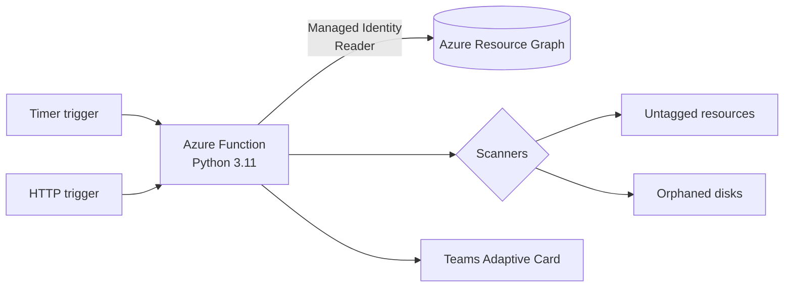

# Azure Governance Bot

Serverless governance and cost-optimization scanner for Microsoft Azure. It inventories every in-scope subscription through Azure Resource Graph, detects governance gaps and wasted spend, and publishes a summary to Microsoft Teams.




## Capabilities

| Check | Detects | Status |
|---|---|---|
| `untagged-resource` | Resources missing required ownership or cost-allocation tags | Available |
| `orphaned-disk` | Unattached managed disks, with estimated monthly cost | Available |
| `idle-resource` | Low-utilization VMs, empty App Service Plans, unused IPs and NICs | Planned |
| `broad-role-assignment` | Owner/Contributor at broad scope, stale or orphaned principals | Planned |
| `cost-anomaly` | Daily spend outside the expected range | Planned |
| Policy enforcement | Deny and modify policies for tagging standards | Planned |

See [docs/ROADMAP.md](docs/ROADMAP.md).

## Key design decisions

- **Azure Resource Graph for inventory.** One KQL query spans all subscriptions and returns from an index, instead of thousands of per-resource ARM calls that are subject to throttling.
- **Secretless authentication.** `DefaultAzureCredential` uses Azure CLI credentials locally and a system-assigned Managed Identity in Azure. No secrets exist in code or configuration.
- **Least privilege.** The identity holds only the built-in Reader role in Phase 1.
- **Read-only by default.** The scanner reports and never modifies resources. Remediation is delegated to Azure Policy.
- **Pluggable scanners.** Each check is a function returning `Finding` objects, registered in `governance/scanners/__init__.py`. Reporting is unaffected by new checks.
- **Thin triggers.** `function_app.py` delegates to `runner.run_scan()`, which the CLI and test suite share.
- **Fault isolation.** A failing scanner is logged and the remaining scanners still report.

Details are in [docs/ARCHITECTURE.md](docs/ARCHITECTURE.md).

## Getting started

```bash
python -m venv .venv && source .venv/bin/activate   # Windows: .venv\Scripts\activate
pip install -r requirements-dev.txt
pytest                                              # no Azure account required

az login
python -m governance.cli -v                         # read-only scan
```

Full first-run walkthrough, including a disposable test environment: [docs/GETTING_STARTED.md](docs/GETTING_STARTED.md).

## Configuration

| Variable | Default | Purpose |
|---|---|---|
| `GOV_SUBSCRIPTION_IDS` | *(all visible)* | Comma-separated subscription IDs to scan |
| `GOV_REQUIRED_TAGS` | `owner,environment,costCenter` | Tags every resource must carry |
| `GOV_SCHEDULE` | `0 0 14 * * 1-5` | NCRONTAB schedule for the timer trigger (UTC) |
| `TEAMS_WEBHOOK_URL` | *(unset)* | Teams Workflow webhook; store as a Key Vault reference |
| `GOV_DRY_RUN` | `true` | Report-only mode |

## Repository layout

```
function_app.py            Azure Functions entry point (timer and HTTP triggers)
governance/
  config.py                Environment-based settings
  models.py                Finding and ScanReport models
  azure_clients.py         Resource Graph client with paging
  runner.py                Scan orchestration
  cli.py                   Command-line entry point
  scanners/                One module per check
  reporting/teams.py       Adaptive Card builder and webhook client
tests/                     pytest suite using an in-memory Resource Graph fake
scripts/                   Test-environment setup and deployment
docs/                      Architecture, getting started, roadmap
```

## License

MIT
