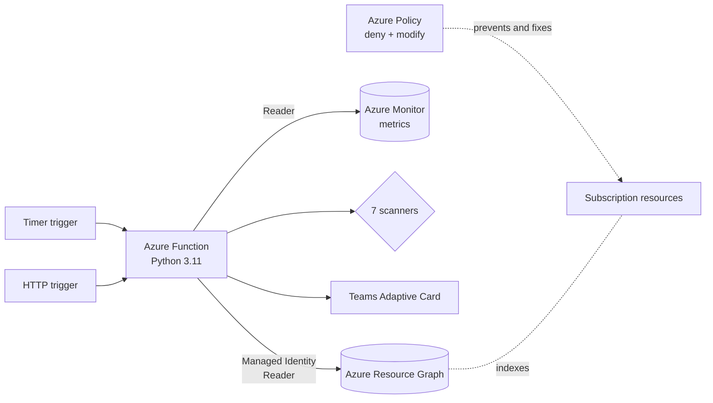

# Azure Governance Bot

Serverless governance and cost-optimization scanner for Microsoft Azure. It inventories every in-scope subscription through Azure Resource Graph, combines that with Azure Monitor metrics to detect governance gaps and wasted spend, and publishes a summary to Microsoft Teams. Azure Policy prevents and auto-remediates tagging gaps, so the scanner reports only what policy can't fix.




## Capabilities

| Check | Detects | Status |
|---|---|---|
| `untagged-resource` | Resources missing required ownership or cost-allocation tags | Available |
| `orphaned-disk` | Unattached managed disks, with estimated monthly cost | Available |
| `orphaned-public-ip` | Public IPs not associated with any NIC, load balancer, gateway or NAT gateway | Available |
| `orphaned-nic` | NICs not attached to a VM (excluding private endpoint and Azure-managed NICs) | Available |
| `empty-app-service-plan` | Paid App Service Plans hosting no apps | Available |
| `stopped-not-deallocated-vm` | VMs stopped from the guest OS that still bill for compute | Available |
| `idle-vm` | Running VMs with low average and low peak CPU over 14 days | Available |
| Policy enforcement | Deny resource groups without `owner`; inherit tags from the resource group | Available |
| `broad-role-assignment` | Owner/Contributor at broad scope, stale or orphaned principals | Planned |
| `cost-anomaly` | Daily spend outside the expected range | Planned |

See [docs/ROADMAP.md](docs/ROADMAP.md).

## Key design decisions

- **Azure Resource Graph for inventory.** One KQL query spans all subscriptions and returns from an index, instead of thousands of per-resource ARM calls that are subject to throttling.
- **Secretless authentication.** `DefaultAzureCredential` uses Azure CLI credentials locally and a system-assigned Managed Identity in Azure. No secrets exist in code or configuration.
- **Least privilege.** The scanner's identity holds only the built-in Reader role, which covers both Resource Graph and Azure Monitor metric reads.
- **Prevent, then detect.** Azure Policy blocks untagged resource groups and copies tags down to resources. The scanner never modifies anything, and reports what policy can't address, such as idle or orphaned resources.
- **Separate write identities.** Each Policy Modify assignment has its own managed identity with only the roles its definition declares, so write access never sits with the scanner.
- **Pluggable scanners.** Each check is a function returning `Finding` objects, registered in `governance/scanners/__init__.py`. Reporting is unaffected by new checks.
- **Injected dependencies.** Scanners receive a `Clients` container (Resource Graph and metrics) instead of creating SDK clients, so tests use in-memory fakes.
- **Thin triggers.** `function_app.py` delegates to `runner.run_scan()`, which the CLI and test suite share.
- **Fault isolation.** A failing scanner is logged and the remaining scanners still report.

Details are in [docs/ARCHITECTURE.md](docs/ARCHITECTURE.md).

## Getting started

```bash
python -m venv .venv && source .venv/bin/activate   # Windows: .venv\Scripts\activate
pip install -r requirements-dev.txt
pytest                                              # no Azure account required

az login
python -m governance.cli -v                         # read-only scan
```

Full first-run walkthrough, including a disposable test environment: [docs/GETTING_STARTED.md](docs/GETTING_STARTED.md).

## Configuration

| Variable | Default | Purpose |
|---|---|---|
| `GOV_SUBSCRIPTION_IDS` | *(all visible)* | Comma-separated subscription IDs to scan |
| `GOV_REQUIRED_TAGS` | `owner,environment,costCenter` | Tags every resource must carry |
| `GOV_SCHEDULE` | `0 0 14 * * 1-5` | NCRONTAB schedule for the timer trigger (UTC) |
| `TEAMS_WEBHOOK_URL` | *(unset)* | Teams Workflow webhook; store as a Key Vault reference |
| `GOV_IDLE_LOOKBACK_DAYS` | `14` | Days of CPU history evaluated for idle VMs |
| `GOV_IDLE_CPU_AVG` | `5` | Average CPU % below which a VM is idle |
| `GOV_IDLE_CPU_MAX` | `20` | Peak CPU % the VM must never exceed to count as idle |
| `GOV_IDLE_MIN_HOURS` | `72` | Minimum hours of metric data before a VM is judged |
| `GOV_DRY_RUN` | `true` | Report-only mode |

## Repository layout

```
function_app.py            Azure Functions entry point (timer and HTTP triggers)
governance/
  config.py                Environment-based settings
  models.py                Finding and ScanReport models
  azure_clients.py         Resource Graph and Azure Monitor clients, Clients container
  runner.py                Scan orchestration
  cli.py                   Command-line entry point
  scanners/                One module per check
  reporting/teams.py       Adaptive Card builder and webhook client
tests/                     pytest suite using in-memory Resource Graph and metrics fakes
scripts/                   Test environment, deployment, Azure Policy assignment
docs/                      Architecture, getting started, roadmap
```

## License

MIT
