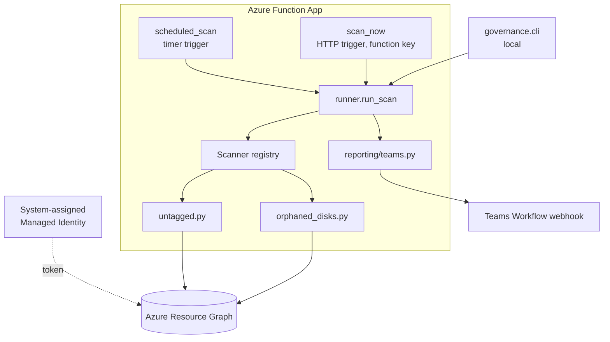

# Architecture

## Components

## Request flow

1. A trigger fires: the timer on schedule, the HTTP endpoint on demand, or the CLI locally.
2. `load_settings()` reads configuration from environment variables.
3. `run_scan()` creates a `ScanReport` and calls each registered scanner.
4. Each scanner sends one KQL query to Resource Graph through the `GraphQuery` interface and converts rows into `Finding` objects.
5. Findings are aggregated. Exceptions in one scanner are logged without stopping the others.
6. If a webhook is configured, an Adaptive Card summary is posted to Teams. The HTTP trigger also returns the full report as JSON.

## Design rationale

### Resource Graph over ARM enumeration
Enumerating resources through ARM means one call per subscription, resource group and resource type, which is slow and hits ARM throttling limits. Resource Graph serves inventory from an index and handles cross-subscription queries in a single call. Results are paged at 1,000 rows, and `ResourceGraph.query()` follows `skip_token` until it has every row.

Trade-off: Resource Graph is eventually consistent, typically within a minute of a change. That is acceptable for a scheduled governance report.

### Identity and access
| Environment | Credential resolved by `DefaultAzureCredential` |
|---|---|
| Local | Azure CLI (`az login`) |
| Azure Functions | System-assigned Managed Identity |

The identity holds **Reader** at subscription scope. Resource Graph returns only resources the caller can read, so scope is controlled by RBAC rather than application logic. Later phases that need write access will use a custom role scoped to the specific actions required.

### Abstraction for testing
Scanners depend on the `GraphQuery` protocol, not on the Azure SDK. Tests inject `FakeGraph`, which returns fixed rows, so the full suite runs offline in milliseconds. The SDK is imported lazily inside `ResourceGraph.__init__`.

### Tag evaluation in Python
Azure tag names are case-insensitive, but Resource Graph returns them as stored. The untagged scanner retrieves tags and compares them case-insensitively in Python. Values that are only whitespace count as missing. At very large estates this filter could move into KQL to reduce payload size.

### Cost estimation
Orphaned-disk cost uses a static per-GB price table to rank findings by impact. It is an estimate and is labelled as one. Phase 4 replaces it with the Azure Retail Prices API and actual cost from Cost Management.

### Severity
| Check | High | Medium | Low |
|---|---|---|---|
| Orphaned disk | ≥ $50/month | ≥ $10/month | < $10/month |
| Untagged resource | n/a | Missing all required tags | Missing some |

## Security considerations
- No secrets in source or app settings. The Teams webhook URL is intended to be a Key Vault reference.
- The HTTP trigger requires a function key (`AuthLevel.FUNCTION`).
- The webhook client rejects non-HTTPS URLs.
- The scanner is read-only. `GOV_DRY_RUN` defaults to `true`.

## Hosting
Azure Functions Flex Consumption: scales to zero and bills per execution, which suits a job that runs for seconds once a day. The function timeout is 10 minutes (`host.json`).
