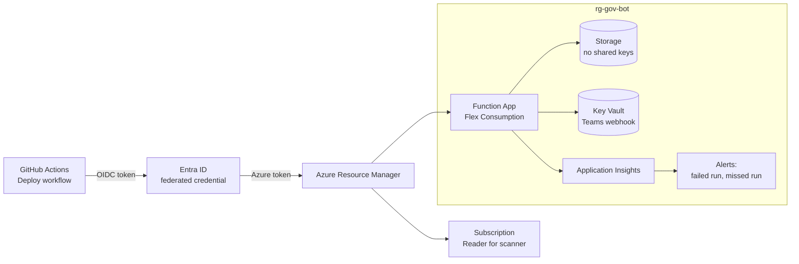

# Deployment

Everything in Azure is defined in `infra/` and deployed the same way from a laptop or from GitHub Actions.



## What the template creates

| Resource | Purpose |
|---|---|
| Resource group `rg-gov-bot` | Tagged `owner`, `environment`, `costCenter`, so it passes the deny policy |
| Function App (Flex Consumption, Python 3.11) | Runs the scanner; system-assigned managed identity |
| Storage account | Host state, deployment package and report history; shared-key access disabled |
| Key Vault (RBAC mode) | Holds the Teams webhook URL; the app reads it via a Key Vault reference |
| Log Analytics + Application Insights | Telemetry |
| Two log alert rules (+ action group if an email is set) | A failed invocation in the last hour; no successful scheduled scan in two days |
| Role assignments | Reader on the subscription; Storage Blob Data Owner on the storage account; Key Vault Secrets User on the vault |

Not in the template: the Microsoft Graph `Directory.Read.All` app role. Graph permissions are granted in Entra ID, not Azure RBAC, and require an administrator, so `scripts/grant-graph-permissions.sh` grants it once after the first deployment.

## Option A: deploy from your machine

Requires the Azure CLI, `jq` and [Azure Functions Core Tools v4](https://learn.microsoft.com/azure/azure-functions/functions-run-local).

```bash
GOV_OWNER=<your-name> GOV_ALERT_EMAIL=<you@example.com> ./scripts/deploy.sh
RG=rg-gov-bot NAME=<function-app-name> ./scripts/grant-graph-permissions.sh
```

## Option B: GitHub Actions with OIDC

### One-time setup
```bash
gh auth login
REPO=<github-user>/azure-governance-bot ./scripts/setup-github-oidc.sh
```
The script:
1. Creates an app registration and service principal for the pipeline.
2. Adds a **federated credential** that trusts tokens only from this repository's `production` environment. GitHub signs a short-lived token per run; Entra ID exchanges it for an Azure token. No secret is ever created.
3. Grants **Contributor** and **Role Based Access Control Administrator**, the latter with a **condition** that allows assigning or removing only Reader, Storage Blob Data Owner and Key Vault Secrets User. Even a compromised workflow cannot grant itself Owner.
4. Creates the `production` environment and the repository variables the workflow reads, including `GOV_RBAC_ALLOWED_PRINCIPALS` set to the pipeline's own principal, because it legitimately holds broad roles.

Optional repository variables: `GOV_OWNER`, `GOV_ALERT_EMAIL`, `AZURE_LOCATION`. Optional secret: `TEAMS_WEBHOOK_URL`.

### How the pipeline runs
| Workflow | Trigger | Jobs |
|---|---|---|
| `ci.yml` | Every push and pull request | Tests with coverage, ruff, Bicep lint and build, shellcheck |
| `deploy.yml` | CI succeeding on `main`, or manual | OIDC login, `az deployment sub create`, code deploy with remote build, smoke test against `/api/scan` |

The deploy job is skipped automatically when `AZURE_CLIENT_ID` isn't configured, so forks and fresh clones don't fail. In GitHub, you can add required reviewers to the `production` environment so every deployment waits for approval.

## After deploying

```bash
# trigger a scan and see the JSON report
RG=rg-gov-bot; APP=<function-app-name>
KEY=$(az functionapp function keys list -g $RG -n $APP --function-name scan_now --query default -o tsv)
curl "https://$(az functionapp show -g $RG -n $APP --query defaultHostName -o tsv)/api/scan?code=$KEY"

# report history
az storage blob list --account-name <storage-account> -c reports --auth-mode login -o table
```
Listing blobs with `--auth-mode login` needs a data-plane role for *you*, such as Storage Blob Data Reader on the account.

## Remove everything
```bash
az group delete -n rg-gov-bot --yes
az role assignment delete --assignee <principalId output> --scope /subscriptions/<sub-id>
```
The second command removes the subscription-level Reader assignment, which lives outside the resource group. Skip it and the scanner's next run reports it as a stale assignment, because the identity it belonged to no longer exists.
